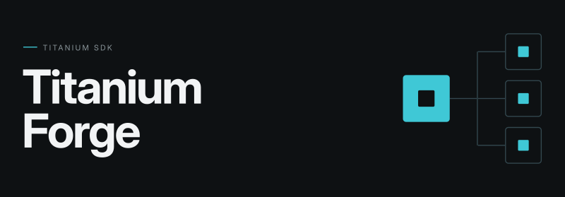

<center></center>

# Titanium Forge (tiforge)

Distributed [Titanium SDK](https://titaniumsdk.com) builds: work on one machine,
build on others. Typical setup: you develop on Linux, a Mac on your network runs
the tiForge daemon, and `ti forge` syncs the project to the Mac and runs the iOS
build there — with the remote log streaming into your local terminal.

```
┌─ Linux (dev machine) ──────────┐        ┌─ Mac ──────────────────────┐
│ ti forge                       │        │ tiforged                   │
│   ├─ 1. manifest diff      ────┼──────► │   ├─ project mirror        │
│   ├─ 2. upload changes     ────┼──────► │   ├─ receives changed files│
│   └─ 3. trigger build      ────┼──────► │   ├─ spawns `ti build ...` │
│       ◄── live log (WS)    ────┼────────┼───└─ streams logs back     │
└────────────────────────────────┘        └────────────────────────────┘
```

Sync is a stateless manifest diff (a poor man's rsync): the client hashes the
project, the daemon answers with what it is missing or has too much of, and only
those files are uploaded as one gzipped tar. Content hashes — not timestamps —
are the source of truth, so clock drift doesn't matter and interrupted uploads
are picked up on the next run. `build/`, `node_modules/` and `.git/` are never
synced; in an Alloy project neither is the top-level `Resources/`, which the
alloy compiler regenerates during the remote build.

## Setup

Requires Node ≥ 22 on both machines.

### On the build machine (Mac)

```sh
git clone <this repo> && cd tiForge && npm install
node bin/tiforged.js --token SOME_SECRET
```

The daemon listens on port 7331, mirrors projects into `~/.tiforge/projects/`,
and announces itself on the LAN via mDNS. Options: `--port`, `--root`,
`--build-cmd` (default `ti`), `--build-timeout` (minutes, default 30),
`--no-advertise`. `tiforged` is a shortcut for `tiforge daemon` and takes the
same flags.

### On the dev machine (Linux)

```sh
git clone <this repo> && cd tiForge && npm install
node bin/tiforge.js install      # registers `ti forge` with the Titanium CLI
```

All settings live in the Titanium CLI's own config (`~/.titanium/config.json`)
under the `forge` node — no per-project config files. Run `ti forge --init` to
discover daemons via mDNS and store them automatically (re-running updates URLs
and keeps your tokens), then set the token. Or do it by hand:

```sh
ti config forge.hosts.mac.url http://192.168.1.3:7331
ti config forge.hosts.mac.token SOME_SECRET
ti config forge.hosts.mac.buildArgs "-p ios -T simulator --no-prompt"
ti config forge.hosts.mac.dir /Volumes/SSD/builds   # optional, see below
ti config forge.token SOME_SECRET         # optional, fallback for hosts without a token
ti config forge.exclude "tmp,docs"        # optional, comma/space separated
```

Every host under `forge.hosts.*` takes part in syncs and builds. `buildArgs` is
a space-separated string (ti config values are strings). A host without its own
`token` uses `forge.token`.

## Usage

```sh
ti forge                  # sync + remote build on all configured hosts
ti forge --force          # same, but kill/cancel remote builds first
ti forge --clear          # stop all builds and empty the queue, nothing else
ti forge --sync           # only push changed files, no build
ti forge --init           # discover daemons into ti config
ti forge --discover       # list tiForge daemons on the network
ti forge --url http://192.168.1.9:7331 --token S   # one ad-hoc daemon instead of the configured hosts
ti forge --dir /Volumes/SSD/builds                 # mirror directory override for this run
```

Remote output appears prefixed with `[tiForge:mac]`, uploads show live progress.
The daemon always enforces `--no-prompt` so nothing hangs on the other machine.
Builds run one at a time per daemon; extra builds queue and the client shows the
queue position. A new build of a project automatically supersedes older builds
of the *same* project — running ones are killed, queued ones cancelled — so a
lingering simulator session never blocks your next build. Builds of other
projects are left alone and queue normally. `--force` remains the big hammer:
it kills and cancels *all* builds on the daemon (including its xcodebuild
children), regardless of project.

Ctrl+C during a build cancels that build on the daemon and waits for its last
log lines. A second Ctrl+C quits at once and leaves the build running. When the
daemon itself is stopped (Ctrl+C or SIGTERM), it kills the running build and
cancels the queued ones before it exits, because builds run detached and the
signal does not reach them on its own.

The same commands exist without the ti CLI (e.g. for CI): `tiforge sync`,
`tiforge build [-- <remote args>]`, `tiforge init`, `tiforge discover`. Make
`tiforge` available everywhere with `npm link` or by symlinking `bin/tiforge.js`
into a directory on your PATH; `npm link` installs `tiforged` alongside it.

### Where the daemon puts the files

The mirror is named after your project's own directory, so `~/dev/MyApp` builds
in `MyApp` — not under its bundle id. Characters a path segment cannot carry are
folded to `-`; `--name` overrides the name outright.

The daemon keeps a hash cache for each mirror in `<root>/.manifest-cache/`, so
a restart does not re-hash every project on the first sync. The cache is an
optimization only: delete the directory and the next sync rebuilds it.

By default a project lands in `~/.tiforge/projects/MyApp`. Set `dir` on a host
to mirror somewhere else instead — an absolute path **on the daemon machine**,
per host, created if it does not exist. The project name is still appended, so
one `dir` serves several projects. Changing it starts an empty mirror at the new
location (the next sync uploads everything once) and leaves the old copy behind.
`ti forge` and `tiforge sync`/`build` take `--dir PATH` for a single run.

## Security notes

- Always set a `--token`. The daemon runs build commands for anyone who presents
  it, with client-supplied arguments — treat it like an SSH key, and only run it
  on trusted networks. There is no TLS yet; put it behind a VPN if the network
  isn't trusted.
- The token is the whole security boundary. A client that has it also picks the
  mirror location (`dir`), so it can write anywhere that user can write.
- Project names are restricted to `[A-Za-z0-9._-]` and tar extraction is
  confined to the project directory.

## Protocol

| Route | Meaning |
| --- | --- |
| `GET /ping` | `{name, platform, version}` of the daemon |
| `POST /projects/:name/manifest` | body `{files, exclude, purge}` → `{needed, deleted}`; `purge` lists generated dirs to delete from the mirror first (`Resources` in an Alloy project) |
| `POST /projects/:name/files` | gzipped tar of the needed files |
| `POST /projects/:name/build` | body `{args}` → `{buildId, ahead}` (builds run serially; `ahead` is the queue position) |
| `GET /builds/:id` | status + exit code |
| `POST /builds/:id/cancel` | kill that build if running, drop it if queued → `{cancelled}` |
| `POST /builds/cancel` | the same for every build on the daemon → `{cancelled}` |
| `WS /builds/:id/log` | `{type:'status',status}` and `{type:'log',data}` frames, then `{type:'exit',code}` |

Auth on every route via the `x-tiforge-token` header. The three
`/projects/:name/*` routes accept `?dir=<absolute path>` to override the
daemon's project root for that request; the project name is appended to it.

## Not yet implemented

- Pull build artifacts (`.app`/`.ipa`) back to the dev machine
- Watch mode for LiveView-style continuous sync
